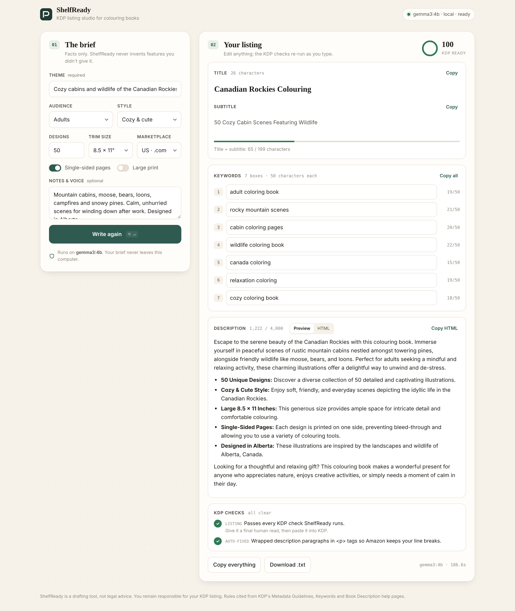
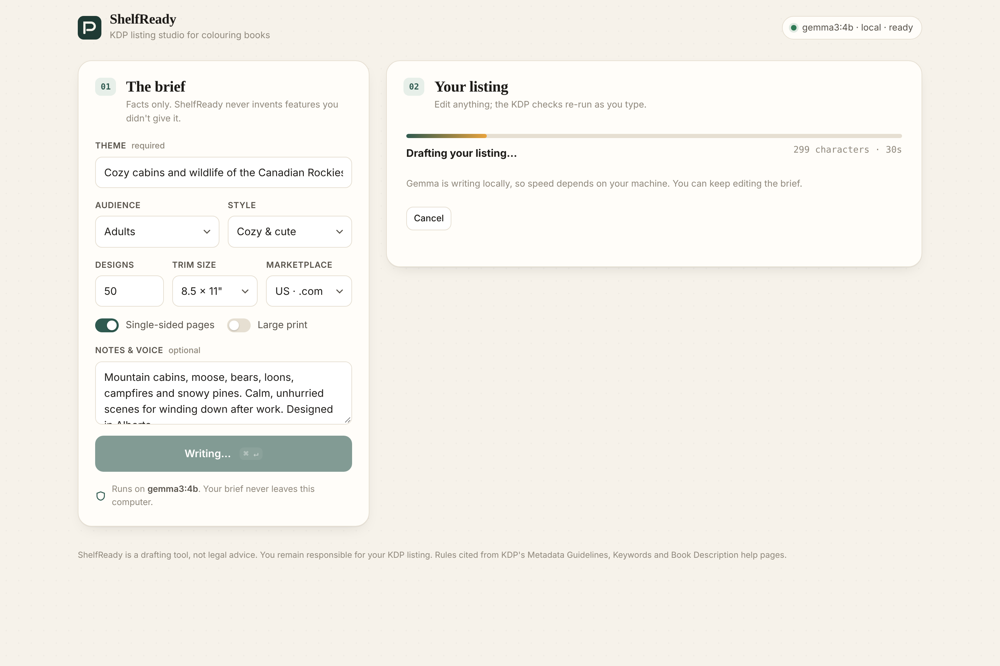
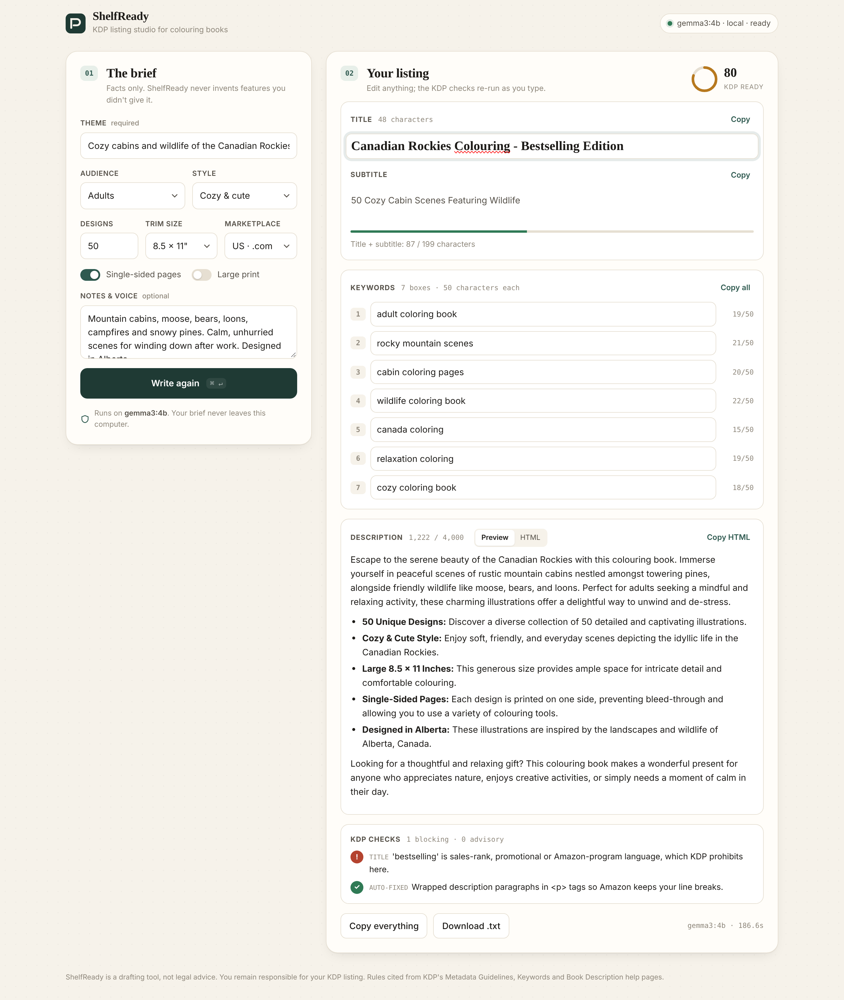
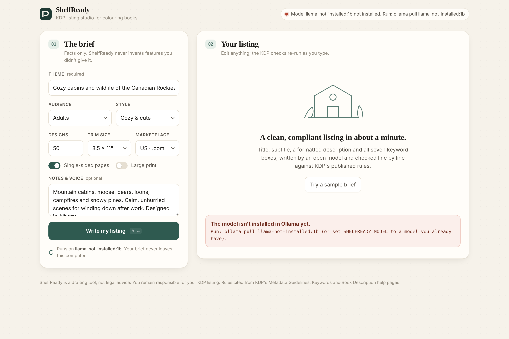

# ShelfReady

**A private, local-first KDP listing studio for colouring-book publishers.**
Give it the facts about your book. It writes the title, subtitle, a formatted description and all seven keyword boxes using **Gemma 3** running on your own machine through **Ollama**, then checks every line against Amazon KDP's published metadata rules before you paste anything into KDP.



> Built for the DEV × Hacktoberfest 2026 Open-Source AI Challenge, Week 2: *Side Hustle*.

---

## Why it exists

Writing a KDP listing takes longer than most people expect, and mistakes cost real money. Generic AI tools will happily write "Bestselling Coloring Book, Perfect Gift, Free Bonus Pages". Every one of those phrases breaks KDP's metadata rules and can get a listing suppressed. ShelfReady splits the job in two:

| The model (Gemma 3, local) | The rules engine (plain Python, deterministic) |
| --- | --- |
| Writes persuasive, specific copy from your facts | Enforces KDP's character limits, banned terms, allowed HTML and keyword hygiene |
| Gets a second pass to fix anything blocking | Makes only mechanical fixes (spacing, tags, US spelling) and tells you which |
| Can be swapped for any Ollama model | Is unit-tested and cites the KDP help page behind every rule |

## What it checks

| Field | Blocking errors | Advisory warnings |
| --- | --- | --- |
| Title / subtitle | Over 199 characters combined · "bestselling", "free", "#1", "new", "sale" · Kindle/Amazon program names · trademark watchlist · HTML | Title over 60 characters (KDP: shoppers skim past it) · repeated generic words · ALL CAPS |
| Keywords (7 × 50 characters) | Over 50 characters · quotes or HTML · promotional, subjective or program terms · brands | Unused boxes · plural/word-order variants · only repeats title words · "colour" spelling on Amazon.com |
| Description (4,000 characters) | Over 4,000 characters · tags outside KDP's allowed list · URLs, emails, phone numbers · emoji · review requests and testimonials · price/promo language | Unclosed tags · thin copy under 300 characters |

Sources: [Metadata Guidelines](https://kdp.amazon.com/en_US/help/topic/G201097560) · [Keywords](https://kdp.amazon.com/en_US/help/topic/G201298500) · [Book Description](https://kdp.amazon.com/en_US/help/topic/G201189630).

## Quick start

Requirements: **Python 3.10+** and **[Ollama](https://ollama.com)**. ShelfReady uses only the Python standard library, so there's nothing to `pip install`.

```bash
# 1. Get the model (about 3 GB, one time)
ollama pull gemma3:4b

# 2. Run ShelfReady
git clone <this repo> shelfready && cd shelfready
python3 -m shelfready
# → ShelfReady 1.0.0 on http://127.0.0.1:8787  (model: gemma3:4b)
```

Open **http://127.0.0.1:8787**, click **Try a sample brief**, then **Write my listing** (or press ⌘/Ctrl + Enter).

### Configuration

| Variable | Default | Purpose |
| --- | --- | --- |
| `SHELFREADY_MODEL` | `gemma3:4b` | Any Ollama chat model: `gemma3:1b` for older laptops, `gemma3:12b` for richer copy |
| `OLLAMA_HOST` | `http://127.0.0.1:11434` | Where Ollama is listening |
| `SHELFREADY_PORT` | `8787` | Web UI port |
| `SHELFREADY_HOST` | `127.0.0.1` | Bind address. It stays on localhost by default. |

<details>
<summary>Offline install of the model from a GGUF file</summary>

If `ollama pull` is blocked on your network, download a Gemma 3 GGUF (for example `gemma-3-4b-it-Q4_K_M.gguf` from Hugging Face) and register it:

```bash
printf 'FROM ./gemma-3-4b-it-Q4_K_M.gguf\n' > Modelfile
ollama create gemma3:4b -f Modelfile
```
</details>

## How it works

```
Browser (vanilla HTML/CSS/JS)
   │  POST /api/generate  (brief)          ◄── NDJSON stream: stage → progress → result | error
   ▼
shelfready/app.py  (http.server, stdlib)
   ├─ validate_brief()        rejects bad input with a human message
   ├─ prompt.py               system prompt + JSON schema (Ollama structured outputs)
   ├─ ollama_client.py        streams tokens from Gemma; friendly errors for "not running" / "model missing" / timeouts
   ├─ kdp_rules.sanitise_listing()  strips quotes, tags and dupes from keywords
   ├─ kdp_rules.apply_fixes()       wraps <p>, repairs HTML nesting, US spelling for .com, each fix reported
   ├─ kdp_rules.check_listing()     the rules engine → errors / warnings / score
   └─ if blocking errors: one repair pass, with the exact errors fed back to Gemma
```

* **Live re-checks.** Every field in the result is editable. Edits re-run the rules through `POST /api/check` in about 250 ms.
* **Safe preview.** The description preview is rebuilt node by node, keeping only KDP's allowed tags and no attributes, so model output can never inject script.
* **Honest by design.** The prompt forbids inventing page counts, paper weights or features you didn't supply.

## Screenshots

| Writing locally | Live check catches a banned word | Clear, actionable errors |
| --- | --- | --- |
|  |  |  |

A 29-second demo (generation sped up 15×) is in [`docs/shelfready-demo.mp4`](docs/shelfready-demo.mp4).

## Performance

Measured on an 8-core cloud VM with **no GPU**, running Gemma 3 4B (Q4_K_M): **38 to 49 seconds** per complete listing with nothing else running. That's slower while screen recording, and much faster on any machine with a GPU or Apple Silicon. Running costs are zero: no API key, no per-listing fee.

## Tests

```bash
python3 -m unittest discover -s tests -v
```
27 tests cover every rule family, the sanitiser and HTML repair (including real malformed Gemma output), brief validation and JSON parsing.

## Project layout

```
shelfready/
  app.py            HTTP server + API
  kdp_rules.py      deterministic KDP rules engine
  prompt.py         system prompt, schema, audience/style vocab
  ollama_client.py  streaming Ollama client
  static/           index.html · styles.css · app.js
tests/              unit tests
docs/               screenshots + demo video
```

## Limitations

* The trademark list is a short tripwire, not legal clearance. It can't know every brand or author name.
* The keyword advice follows KDP's guidance, not live Amazon search volume.
* ShelfReady drafts. You remain responsible for what you publish on KDP.

## Credits

Built by Cody Topp with AI assistance: an AI coding agent wrote most of the code to my product brief, and I directed the design and rules.
Runs on [Gemma 3](https://ai.google.dev/gemma) (Google, open weights, Gemma Terms of Use) via [Ollama](https://github.com/ollama/ollama) (MIT).
Rules paraphrase Amazon KDP's public help pages.

## Build log

Created October 18, 2026, within the Week 2 entry window (Oct 12 to 18, 2026, 11:59 PM PDT). Any commits after the deadline will be listed here.

## License

[MIT](LICENSE) © 2026 Cody Topp
